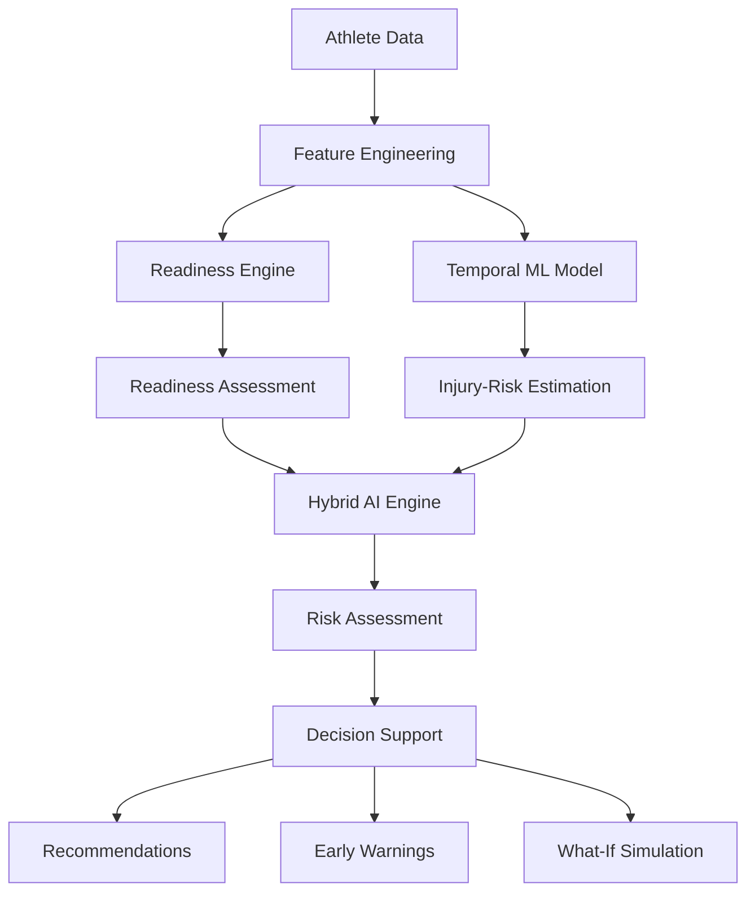

# AIRA
### Athlete Insight, Readiness & Analytics

**An AI-Powered Athlete Readiness & Injury-Risk Decision Support System**

AIRA is an AI-powered decision-support system designed to help coaches and sports teams gain deeper insights into athlete readiness, monitor training workloads, evaluate recovery indicators, and identify potential injury-risk patterns.

By combining rule-based assessment with temporal machine learning, AIRA analyzes multiple athlete performance and recovery indicators to provide structured insights, early warnings, and data-driven recommendations.

The system also introduces What-If simulations, allowing coaches to explore alternative training scenarios and understand how potential changes may influence athlete readiness.

---

## Project Overview

Athlete readiness is influenced by several interconnected factors, including training intensity, sleep quality, recovery, reaction time, and workload variations.

Relying on individual indicators may not provide a complete picture of an athlete's condition. AIRA addresses this challenge by integrating these factors into a unified analytical framework.

The project aims to support more informed training decisions through artificial intelligence, machine learning, and explainable decision-support mechanisms.

## Problem Statement

Sports teams often face challenges when monitoring athlete readiness and managing training workloads.

Some of these challenges include:

- Difficulty combining multiple performance and recovery indicators.
- Limited visibility into changes in individual workload patterns.
- Challenges identifying early warning signals associated with increased injury risk.
- Lack of integrated analytical tools for evaluating alternative training scenarios.
- Difficulty translating athlete monitoring data into actionable insights.

## Proposed Solution

AIRA introduces a hybrid AI-based approach that combines a rule-based readiness engine with a temporal machine-learning model.

The system analyzes athlete measurements and historical baselines to calculate readiness scores, estimate potential injury-risk probabilities, and generate interpretable recommendations.

By integrating these components, AIRA aims to provide coaches with a more comprehensive view of athlete readiness and support data-informed training decisions.

## Key Features

### 1. Athlete Readiness Assessment
Evaluates athlete readiness using multiple indicators, including:
- Recovery score
- Sleep duration and quality
- Training workload
- Reaction time
- Recent injury context

### 2. Training Load Analysis
Analyzes training intensity and workload through:
- Session Load
- Acute Workload
- Chronic Workload
- Acute-to-Chronic Workload Ratio (ACWR)
- Historical baseline deviations

### 3. Machine Learning Injury-Risk Estimation
Uses a temporal machine-learning model to estimate injury-risk probability based on engineered athlete performance and recovery features.

### 4. Hybrid AI Assessment
Combines two assessment approaches:
- Rule-Based Readiness Engine
- Temporal Machine Learning Risk Model

The hybrid engine integrates their outputs to provide a consolidated risk assessment.

### 5. Early Warning System
Highlights relevant changes in athlete indicators to help identify patterns that may require attention.

### 6. Explainable Recommendations
Provides understandable factors and recommendations based on athlete readiness indicators and risk assessments.

### 7. What-If Scenario Simulation
Allows coaches to simulate hypothetical changes to training and recovery variables and compare potential assessment outcomes without modifying the original athlete data.

### 8. Event Readiness Assessment
Includes event-focused readiness assessment to support athlete preparation for upcoming competitions.

### 9. Team Management
Provides functionality for managing:
- Athlete profiles
- Training sessions
- Training attendance
- Team information
- Match records
- Athlete contracts
- Achievements

### 10. Data Visualization
Uses interactive dashboards and charts to present athlete metrics, workload trends, and team information.

---

## How AIRA Works

AIRA follows a multi-stage analytical workflow:

1. **Data Collection:** Athlete measurements and historical baseline information are provided.
2. **Feature Engineering:** Training load, workload ratios, recovery indicators, and deviations are calculated.
3. **Readiness Assessment:** The rule-based engine evaluates athlete readiness and generates supporting indicators.
4. **Machine Learning Prediction:** The temporal ML model estimates injury-risk probability using engineered features.
5. **Hybrid Assessment:** Both assessment outputs are integrated into a consolidated risk evaluation.
6. **Decision Support:** The system presents readiness scores, risk indicators, early warnings, and recommendations.
7. **What-If Simulation:** Coaches can explore hypothetical training adjustments and compare their potential effects.

## System Architecture



---

## Technology Stack

| Category | Technologies |
|---|---|
| Programming Language | Python |
| Frontend | Streamlit |
| Backend | FastAPI, Uvicorn |
| Machine Learning | Scikit-learn, Joblib |
| Data Processing | Pandas, NumPy, SciPy |
| Data Visualization | Plotly |
| Database | SQLite |
| Data Validation | Pydantic |
| Testing | Pytest |
| Version Control | Git, GitHub |

## Repository Structure

```text
AIRA/
│
├── ai/
│   ├── explainability/
│   ├── features/
│   ├── hybrid/
│   ├── models/
│   └── scoring/
│
├── backend/
│   ├── main.py
│   └── database.py
│
├── data/
│   ├── database/
│   ├── generator/
│   ├── modeling/
│   ├── processed/
│   └── raw/
│
├── frontend/
│   └── app/
│       └── app.py
│
├── tests/
│   ├── test_ai_engine.py
│   ├── test_hybrid.py
│   ├── test_hybrid_integration.py
│   └── test_hybrid_scenarios.py
│
├── requirements.txt
├── .env.example
├── .gitignore
└── README.md
```

---

## Getting Started

Follow these instructions to run AIRA locally.

### Prerequisites

- Python
- Git
- pip

### 1. Clone the Repository

```bash
git clone https://github.com/hanan-alharbi-cs/AIRA.git
cd AIRA
```

### 2. Create a Virtual Environment

**Windows:**

```bash
python -m venv .venv
.venv\Scripts\activate
```

**macOS / Linux:**

```bash
python3 -m venv .venv
source .venv/bin/activate
```

### 3. Install Dependencies

```bash
python -m pip install --upgrade pip
pip install -r requirements.txt
```

### 4. Run the Backend API

From the project root, start the FastAPI server:

```bash
uvicorn backend.main:app --reload --port 8001
```

The backend will run locally at:

http://127.0.0.1:8001

### 5. Run the Frontend Application

Open a second terminal, activate the virtual environment, and run:

```bash
streamlit run frontend/app/app.py
```

The Streamlit application will open in your browser.

### 6. Access API Documentation

FastAPI provides interactive API documentation for exploring and testing available endpoints.

- API Documentation: http://127.0.0.1:8001/docs
- Health Check: http://127.0.0.1:8001/health

---

## API Endpoints

The FastAPI backend provides the following endpoints:

| Method | Endpoint | Description |
|---|---|---|
| GET | `/` | API service information |
| GET | `/health` | Backend health check |
| POST | `/get_player_readiness` | Calculates athlete readiness |
| POST | `/get_hybrid_risk` | Performs hybrid risk assessment |
| POST | `/get_what_if` | Simulates hypothetical scenarios |

For request schemas and response details, visit the interactive API documentation at `/docs` after starting the backend.

---

## Testing

AIRA includes unit and integration tests covering the AI engine and hybrid assessment workflows.

To run the test suite:

```bash
pytest -q
```

---

## Demo & Project Preview

**Live Demo:**

[Launch AIRA – Interactive Demo](https://tp9cdmkudbq9svafbkkzoq.streamlit.app/)

**Project Walkthrough:** To be added.

Screenshots and a demonstration video will be included here when available.

---

## Limitations & Responsible Use

AIRA is currently a prototype developed using synthetic development data.

- Model predictions have not been established as clinically validated injury predictions.
- Risk estimates are decision-support indicators, not medical diagnoses.
- The system does not replace professional medical evaluation.
- Training and return-to-play decisions should involve qualified sports and healthcare professionals.
- Further validation using representative real-world sports datasets is required.

---

## Future Improvements

- Validate model performance using representative real-world athlete datasets.
- Improve prediction reliability and model evaluation.
- Expand explainability and feature interpretation.
- Enhance longitudinal athlete monitoring.
- Strengthen data privacy and security.
- Introduce additional analytical capabilities for coaches and sports teams.

---

## Author

**Hanan Alharbi**

Computer Science | Artificial Intelligence | Machine Learning

GitHub: [hanan-alharbi-cs](https://github.com/hanan-alharbi-cs)

---

*AIRA explores the intersection of Artificial Intelligence, Machine Learning, and Sports Analytics to support smarter athlete monitoring and data-driven decisions.*
