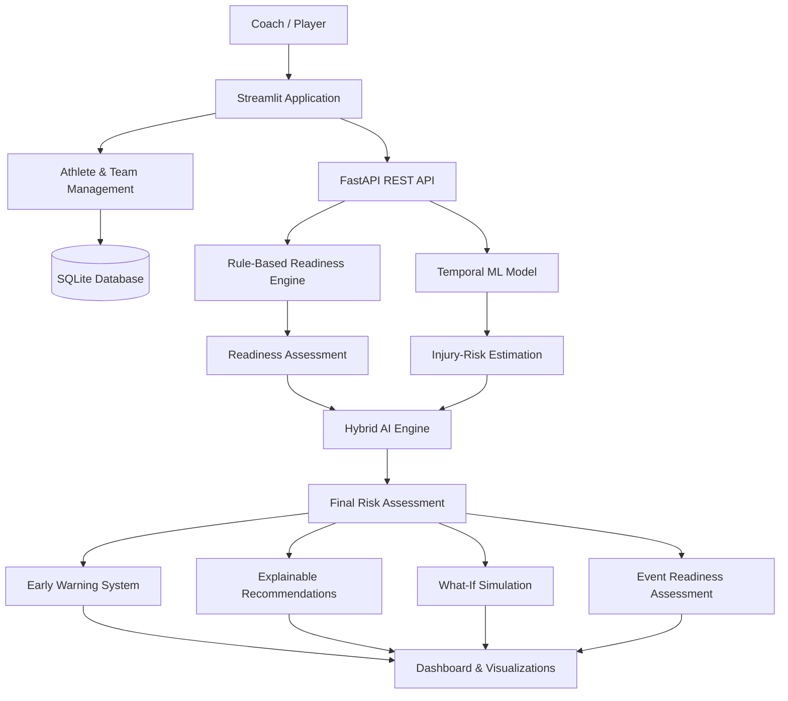

# AIRA | Athlete Insight, Readiness & Analytics

### An AI-Powered Athlete Readiness & Injury-Risk Decision Support System

**AIRA** is an AI-powered decision-support system designed to help coaches and sports teams gain deeper insights into athlete readiness, monitor training workloads, evaluate recovery indicators, and identify potential injury-risk patterns.

By combining a rule-based readiness engine with a temporal machine-learning model, AIRA analyzes athlete performance and recovery indicators to provide structured insights, early warnings, and data-driven recommendations.

The system also introduces What-If simulations and event readiness assessments, allowing coaches to explore alternative training scenarios and better understand athlete readiness before upcoming competitions.

**My Role:** Team Lead | Team of 3

**Live Demo:** [Launch AIRA – Live Application](https://tp9cdmkudbq9svafbkkzoq.streamlit.app/)

**GitHub Repository:** [hanan-alharbi-cs/AIRA](https://github.com/hanan-alharbi-cs/AIRA)

---

## Project Overview

Athlete readiness is influenced by several interconnected factors, including training intensity, sleep quality, recovery, reaction time, workload variations, and injury context.

Relying on individual indicators may not provide a complete picture of an athlete's condition.

AIRA addresses this challenge by integrating these factors into a unified analytical framework that evaluates readiness, estimates potential injury-risk probability, and provides interpretable recommendations.

The project aims to support more informed training decisions through artificial intelligence, machine learning, sports analytics, and explainable decision-support mechanisms.

## Problem Statement

Sports teams often face challenges when monitoring athlete readiness and managing training workloads.

Some of these challenges include:

- Difficulty combining multiple performance and recovery indicators.
- Limited visibility into changes in individual workload patterns.
- Challenges identifying early warning signals associated with increased injury risk.
- Lack of integrated analytical tools for evaluating alternative training scenarios.
- Difficulty translating athlete monitoring data into actionable insights.
- Limited ability to evaluate readiness in relation to upcoming competitions.

## Proposed Solution

AIRA introduces a hybrid AI-based approach that combines two analytical layers:

1. **Rule-Based Readiness Engine:** Evaluates athlete readiness using performance, recovery, workload, and historical baseline indicators.
2. **Temporal Machine Learning Model:** Estimates potential injury-risk probability using engineered temporal features.

The hybrid engine combines the outputs of both approaches into a consolidated risk assessment.

AIRA also provides early warning indicators, explainable recommendations, event readiness assessments, and What-If simulations to help coaches explore potential training and recovery adjustments.

---

## Key Features

### 1. Athlete Readiness Assessment

Evaluates athlete readiness using multiple indicators:

- Recovery score.
- Sleep duration.
- Sleep quality.
- Training workload.
- Reaction time.
- Historical athlete baselines.
- Recent injury context.

The readiness engine generates:

- Readiness score (0–100).
- Readiness risk classification.
- Supporting performance and recovery factors.
- Data quality indicator.
- Personalized rule-based recommendations.

### 2. Training Load Analysis

Analyzes athlete training intensity and workload through:

- **Session Load:** Calculated using training duration multiplied by Rate of Perceived Exertion (RPE).
- **Acute Workload:** Calculated from recent training loads over the most recent seven days.
- **Chronic Workload:** Calculated as the average of the most recent 28 days of available training loads.
- **Acute-to-Chronic Workload Ratio (ACWR):** Compares acute workload with chronic workload.
- **Historical Baseline Deviations:** Evaluates changes in workload, sleep, and reaction time relative to athlete-specific baselines.

These metrics help identify workload changes and provide additional context for readiness assessments.

### 3. Temporal Machine Learning Injury-Risk Estimation

Uses a trained Logistic Regression model to estimate potential injury-risk probability.

The model uses engineered temporal features, including:

- Session load.
- Acute load.
- Chronic load.
- ACWR.
- Sleep deviation.
- Reaction-time deviation.
- Recovery drop.
- Early-warning points.

The model predicts the likelihood of an injury-related target within the next 1–3 matches, based on the project's temporal training dataset.

The trained model is stored as a Joblib artifact and loaded by the backend for inference.

### 4. Hybrid AI Assessment

Combines two assessment approaches:

- Rule-Based Readiness Engine.
- Temporal Machine Learning Risk Model.

The hybrid engine receives raw athlete measurements and historical baselines for readiness evaluation, while the ML model receives engineered temporal features.

The two outputs are combined using a conservative risk policy:

- If either engine reports elevated risk, the final risk is elevated.
- If neither reports elevated risk but at least one reports moderate risk, the final risk is moderate.
- The final risk is low only when both engines report low risk.

This approach ensures that the strongest risk signal is considered in the final assessment.

### 5. Early Warning System

Identifies combinations of athlete indicators that may require attention.

The early-warning engine considers five signals:

- Workload spike.
- Sleep deviation.
- Recovery drop.
- Reaction-time deviation.
- Recent injury context.

The prototype assigns warning points based on the detected signals:

| Warning Points | Risk Level |
|---|---|
| 0–1 | Low |
| 2–3 | Moderate |
| 4–5 | Elevated |

The early-warning system combines multiple indicators instead of relying on ACWR alone.

### 6. Explainable Recommendations

Provides understandable explanations and recommendations based on athlete readiness indicators and risk assessments.

The system presents:

- Factors contributing to readiness assessment.
- Positive and negative indicator directions.
- Workload and recovery deviations.
- Early warning signals.
- Recommendations based on the athlete's current condition.
- Combined hybrid risk guidance.

### 7. What-If Scenario Simulation

Allows coaches to simulate hypothetical changes to training and recovery variables.

Supported scenario changes include:

- Training duration.
- RPE.
- Sleep duration.
- Sleep quality.
- Recovery score.
- Session load.
- Acute workload.
- ACWR.
- Recovery drop.
- Early-warning points.

The simulator compares the athlete's current state with a temporary scenario and presents:

- Current readiness score.
- Scenario readiness score.
- Current and scenario injury-risk probabilities.
- Current and scenario risk classifications.
- Changes in readiness and risk.
- Scenario recommendations and interpretation.

The original athlete data is not modified or persisted when running a temporary simulation.

### 8. Event Readiness Assessment

Provides an event-focused readiness assessment for upcoming training sessions, matches, and competitions.

The assessment considers:

- Current readiness score.
- Final hybrid risk level.
- Number of days remaining until the event.
- Event importance.

The system generates:

- Event readiness score.
- Event readiness status.
- Event-specific recommendation.
- Preparation and monitoring guidance.

Event importance is treated as a planning context and does not override athlete readiness or risk indicators.

### 9. Athlete and Team Management

Provides functionality for managing athlete and team information, including:

- Athlete profiles.
- Team information.
- Athlete observations.
- Training sessions.
- Individual training attendance.
- Team training sessions.
- Team training attendance.
- Match records and results.
- Upcoming events.
- Athlete contracts.
- Athlete achievements.

The application also supports coach and player account roles.

### 10. Match and Competition Management

Supports the management of previous matches and upcoming competitions.

Features include:

- Previous match records.
- Upcoming match schedules.
- Competition information.
- Match results.
- Home and away teams.
- Venue information.
- Match importance.
- Event preparation.

Upcoming event information can be imported from the project's event dataset.

### 11. Interactive Dashboard and Data Visualization

Uses Streamlit and Plotly to present athlete and team information.

The dashboard provides visual access to:

- Team readiness overview.
- Risk distribution.
- Athlete readiness scores.
- Workload indicators.
- Early warning alerts.
- Upcoming event readiness.
- Match information.
- What-If scenario comparisons.
- Athlete management information.

---

## Application Screenshots

Explore the main interfaces and features of AIRA through the following screenshots.

### 1. Team Readiness Dashboard

Provides an overview of team risk distribution, current risk levels, and average athlete readiness.


---

### 2. Upcoming Event Readiness

Displays athlete readiness scores and risk assessments for upcoming sporting events.


---

### 3. Athlete Data Input

Allows coaches to enter athlete training measurements and performance indicators.


---

### 4. Early Warning Alerts & What-If Simulator

Highlights training workload warnings and provides access to interactive scenario simulations.


---

### 5. What-If Scenario Analysis

Compares athlete readiness and risk indicators before and after hypothetical training interventions.


---

### 6. Match Management & Upcoming Events

Provides tools for managing match records and monitoring upcoming competitions.


---

## How AIRA Works

AIRA follows a multi-stage analytical workflow:

1. **Data Collection:** Athlete measurements, training information, and historical baseline information are entered or retrieved.
2. **Feature Engineering:** Training load, workload ratios, recovery indicators, and baseline deviations are calculated.
3. **Readiness Assessment:** The rule-based engine evaluates athlete readiness and generates supporting indicators.
4. **Machine Learning Prediction:** The temporal ML model estimates injury-risk probability using engineered features.
5. **Hybrid Assessment:** Both assessment outputs are integrated into a consolidated risk evaluation.
6. **Early Warning Analysis:** Multiple workload, sleep, recovery, reaction-time, and injury-context signals are evaluated.
7. **Decision Support:** The system presents readiness scores, risk indicators, early warnings, and recommendations.
8. **Event Readiness:** Athlete readiness is evaluated in relation to upcoming competitions.
9. **What-If Simulation:** Coaches can explore hypothetical training adjustments and compare their potential effects.

---

## System Architecture

AIRA follows a modular architecture consisting of a Streamlit application, a FastAPI backend, a rule-based readiness engine, a temporal machine-learning model, and a local SQLite database.



### Frontend – Streamlit Application

The frontend provides the interactive interface for coaches and players.

Its responsibilities include:

- User login and role-based access.
- Athlete profiles and team information.
- Athlete measurements and readiness inputs.
- Training session management.
- Training attendance management.
- Match and event management.
- Readiness and risk dashboards.
- Early warning alerts.
- What-If scenario interaction.
- Event readiness visualization.
- Athlete contracts and achievements.

### Backend – FastAPI REST API

The backend provides API endpoints for readiness assessment, hybrid risk evaluation, and What-If simulations.

Its responsibilities include:

- Request validation using Pydantic.
- Rule-based readiness calculations.
- Temporal ML inference.
- Hybrid risk combination.
- Scenario simulation.
- Structured API responses.
- Error handling and HTTP status codes.

### AI & Machine Learning Layer

The AI layer combines a transparent rule-based engine with a trained machine-learning model.

Its responsibilities include:

- Athlete readiness scoring.
- Feature engineering.
- Historical baseline deviation calculations.
- Early warning signal aggregation.
- Temporal injury-risk prediction.
- Hybrid risk classification.
- Explainable recommendations.

### Database Layer

AIRA uses SQLite for local application data storage.

The database manages:

- User accounts and roles.
- Athlete profiles.
- Athlete observations.
- Upcoming events.
- Individual training sessions.
- Training attendance.
- Team training sessions.
- Team training attendance.
- Match records.
- Player contracts.
- Player achievements.

The database is initialized through the application and uses the project database layer in `backend/database.py`.

---

## AI and Machine Learning Design

AIRA uses a hybrid decision-support architecture that separates rule-based readiness assessment from machine-learning injury-risk estimation.

### 1. Rule-Based Readiness Engine

The Readiness Engine calculates a readiness score from five weighted components:

| Component | Weight |
|---|---:|
| Recovery | 30% |
| Sleep | 25% |
| Workload Balance | 20% |
| Reaction Time | 15% |
| Injury Context | 10% |

The resulting readiness score is bounded between 0 and 100.

The prototype classifies readiness risk as follows:

| Readiness Score | Risk Level |
|---|---|
| 70–100 | Low |
| 40–69 | Moderate |
| 0–39 | Elevated |

The engine also calculates supporting metrics, subscores, baseline deviations, and recommendations.

### 2. Temporal Machine Learning Model

The temporal injury-risk model is implemented using a Scikit-learn Logistic Regression pipeline.

The model uses the following eight engineered features:

| Feature | Description |
|---|---|
| `session_load` | Current training session load |
| `acute_load` | Recent acute workload |
| `chronic_load` | Chronic workload baseline |
| `acwr` | Acute-to-Chronic Workload Ratio |
| `sleep_deviation` | Sleep deviation from baseline |
| `reaction_time_deviation` | Reaction-time deviation from baseline |
| `recovery_drop` | Recovery decrease indicator |
| `warning_points` | Aggregated early-warning points |

The training pipeline includes:

- Median imputation.
- StandardScaler.
- Logistic Regression.
- Class balancing.
- Stratified group cross-validation by player.

The model uses a temporal target representing an injury-related event within the next 1–3 matches.

Grouping by player during cross-validation helps prevent observations from the same athlete from appearing across training and validation folds.

### 3. Hybrid Risk Classification

The ML model produces an injury-risk probability between 0 and 1.

The prototype ML risk thresholds are:

| ML Probability | Risk Level |
|---|---|
| Below 0.40 | Low |
| 0.40–0.69 | Moderate |
| 0.70–1.00 | Elevated |

The hybrid engine combines the ML risk classification with the rule-based readiness risk.

The highest risk level reported by either engine determines the final hybrid risk level.

These thresholds are prototype decision-support settings and require further validation using representative real-world datasets.

### 4. Early Warning Logic

The early-warning engine evaluates five signals:

- Workload increase greater than 20% relative to the baseline.
- Sleep deviation below -15%.
- Recovery score below 60.
- Reaction-time deviation greater than 10%.
- Recent injury context.

Each detected signal contributes one warning point.

The final warning level is determined by the number of detected signals.

This multi-signal approach provides additional context beyond workload-ratio analysis alone.

### 5. What-If Decision Support

The What-If engine compares the original athlete state with a temporary modified scenario.

It runs the readiness and hybrid engines for both states and calculates the differences in:

- Readiness score.
- ML injury-risk probability.
- Readiness risk level.
- Final hybrid risk level.

Scenario changes are applied to a copy of the original input and do not modify the original athlete record.

### 6. Event Readiness Logic

The event readiness engine considers the current readiness score, hybrid risk level, days until the event, and event importance.

It adjusts the readiness assessment using risk and event timing considerations and generates an event-specific status and recommendation.

Event readiness is intended for planning and monitoring, not medical clearance.

---

## Technology Stack

### Programming Language & Application

| Component | Technologies |
|---|---|
| Programming Language | Python |
| Frontend Framework | Streamlit |
| Backend Framework | FastAPI |
| API Server | Uvicorn |
| Data Validation | Pydantic |

### Artificial Intelligence & Machine Learning

| Component | Technologies |
|---|---|
| Machine Learning | Scikit-learn |
| ML Algorithm | Logistic Regression |
| Model Persistence | Joblib |
| Data Preprocessing | SimpleImputer |
| Feature Scaling | StandardScaler |
| Model Pipeline | Scikit-learn Pipeline |
| Cross-Validation | StratifiedGroupKFold |
| Explainability | Custom Rule-Based Explanation Engine |

### Data Processing & Visualization

| Component | Technologies |
|---|---|
| Data Manipulation | Pandas |
| Numerical Computing | NumPy |
| Scientific Computing | SciPy |
| Interactive Visualization | Plotly |
| Image Utilities | Pillow |

### Database & Testing

| Component | Technologies |
|---|---|
| Database | SQLite |
| Database Access | Python sqlite3 |
| Testing Framework | Pytest |
| Version Control | Git |
| Code Hosting | GitHub |

---

## API Endpoints

The FastAPI backend exposes the following endpoints:

| Method | Endpoint | Description |
|---|---|---|
| GET | `/` | API service information and status |
| GET | `/health` | Backend health check |
| POST | `/get_player_readiness` | Calculates athlete readiness using the rule-based engine |
| POST | `/get_hybrid_risk` | Performs hybrid readiness and ML injury-risk assessment |
| POST | `/get_what_if` | Simulates hypothetical athlete training and recovery scenarios |

### API Documentation

FastAPI provides interactive API documentation.

After starting the backend, access:

- **Swagger UI:** `http://127.0.0.1:8001/docs`
- **Health Check:** `http://127.0.0.1:8001/health`

The API request and response models are defined using Pydantic.

---

## Repository Structure

```text
AIRA/
│
├── ai/
│   ├── explainability/
│   │   └── rules_explainer.py
│   │
│   ├── features/
│   │   ├── baseline_features.py
│   │   ├── load_features.py
│   │   └── recovery_features.py
│   │
│   ├── hybrid/
│   │   └── hybrid_risk_engine.py
│   │
│   ├── models/
│   │   ├── injury_risk_baseline.joblib
│   │   ├── temporal_injury_risk_baseline.joblib
│   │   ├── model_adapter.py
│   │   └── readiness_contract.py
│   │
│   └── scoring/
│       ├── early_warning.py
│       ├── event_readiness.py
│       ├── readiness_engine.py
│       ├── readiness_service.py
│       ├── risk.py
│       └── what_if.py
│
├── assets/
│   ├── Team Readiness Dashboard.PNG
│   ├── Upcoming Event Readiness.PNG
│   ├── Athlete Data Input.PNG
│   ├── Early Warning Alerts & What-If Simulator.PNG
│   ├── What-If Scenario Analysis.PNG
│   └── Match Management & Upcoming Events.PNG
│
├── backend/
│   ├── main.py
│   └── database.py
│
├── data/
│   ├── database/
│   ├── generator/
│   ├── modeling/
│   ├── processed/
│   └── raw/
│
├── frontend/
│   └── app/
│       └── app.py
│
├── tests/
│   ├── test_ai_engine.py
│   ├── test_hybrid.py
│   ├── test_hybrid_integration.py
│   └── test_hybrid_scenarios.py
│
├── requirements.txt
├── .env.example
├── .gitignore
└── README.md
```

---

## Getting Started

Follow these instructions to run AIRA locally.

### Prerequisites

Make sure you have the following installed:

- Python
- Git
- pip

### 1. Clone the Repository

```bash
git clone https://github.com/hanan-alharbi-cs/AIRA.git

cd AIRA
```

### 2. Create a Virtual Environment

**Windows:**

```bash
python -m venv .venv

.venv\Scripts\activate
```

**macOS / Linux:**

```bash
python3 -m venv .venv

source .venv/bin/activate
```

### 3. Install Dependencies

Upgrade pip and install the required packages:

```bash
python -m pip install --upgrade pip

pip install -r requirements.txt
```

### 4. Run the Backend API

From the project root, start the FastAPI server:

```bash
uvicorn backend.main:app --reload --port 8001
```

The backend will be available at:

`http://127.0.0.1:8001`

### 5. Run the Frontend Application

Open a second terminal, activate the virtual environment, and run:

```bash
streamlit run frontend/app/app.py
```

The Streamlit application will open in your browser.

The frontend uses the following default API address:

`http://127.0.0.1:8001`

To configure a different API address, set the `AIRA_API_URL` environment variable before starting Streamlit.

**Windows PowerShell:**

```powershell
$env:AIRA_API_URL="http://127.0.0.1:8001"
```

**macOS / Linux:**

```bash
export AIRA_API_URL="http://127.0.0.1:8001"
```

### 6. Demo Accounts

The application provides demo login accounts:

| Role | Username | Password |
|---|---|---|
| Coach | `coach` | `coach123` |
| Player | `player` | `player123` |

These accounts are intended for demonstration and local testing.

### 7. Access API Documentation

After starting the backend, access the interactive API documentation:

- API Documentation: `http://127.0.0.1:8001/docs`
- Health Check: `http://127.0.0.1:8001/health`

---

## Model Training

AIRA includes a temporal model training pipeline and a saved Joblib model artifact.

The temporal model training script is located at:

`data/modeling/train_temporal_model.py`

To train the model from the project root:

```bash
python data/modeling/train_temporal_model.py
```

The training pipeline:

1. Loads the temporal injury dataset.
2. Validates the required feature and target columns.
3. Builds a preprocessing and Logistic Regression pipeline.
4. Uses StratifiedGroupKFold cross-validation grouped by player.
5. Generates out-of-fold predictions.
6. Calculates classification evaluation metrics.
7. Saves prediction results.
8. Fits the final model on the available dataset.
9. Saves the trained model to:

`ai/models/temporal_injury_risk_baseline.joblib`

**Note:** The training dataset is synthetic development data. Model performance should not be interpreted as evidence of clinical validity.

---

## Testing

AIRA includes unit and integration tests covering the AI engine, hybrid assessment, and scenario simulation workflows.

The test suite includes:

- Readiness engine tests.
- Hybrid risk assessment tests.
- Hybrid integration tests.
- What-If scenario tests.

To run the tests:

```bash
pytest -q
```

---

## Live Demo

Explore the deployed AIRA application:

[Launch AIRA – Live Demo](https://tp9cdmkudbq9svafbkkzoq.streamlit.app/)

---

## Project Demo Video

Watch the project walkthrough to explore AIRA's interface, features, and decision-support capabilities.

[](https://youtu.be/0rxrEvFUUQc)

[Watch AIRA – Project Demo on YouTube](https://youtu.be/0rxrEvFUUQc)

---

## Limitations & Responsible Use

AIRA is a prototype developed using synthetic development data.

- Model predictions have not been established as clinically validated injury predictions.
- Risk estimates are decision-support indicators, not medical diagnoses.
- The system does not replace professional medical evaluation.
- Event readiness assessments are not medical clearance.
- Risk thresholds are prototype settings and require validation using independent, representative datasets.
- Synthetic data may not represent the diversity and complexity of real-world athlete populations.
- Training and return-to-play decisions should involve qualified sports and healthcare professionals.
- Further validation using representative real-world sports datasets is required before relying on predictions in operational sports environments.

---

## Future Improvements

- Validate model performance using representative real-world athlete datasets.
- Improve prediction reliability and model evaluation.
- Expand explainability and feature interpretation.
- Enhance longitudinal athlete monitoring.
- Strengthen data privacy and security.
- Improve athlete-specific baseline calculations.
- Introduce additional analytical capabilities for coaches and sports teams.
- Expand event readiness and training scenario analysis.
- Explore integrations with reliable athlete monitoring and performance data sources.

---

## Project Links

- **Live Application:** [AIRA – Athlete Readiness & Analytics](https://tp9cdmkudbq9svafbkkzoq.streamlit.app/)
- **GitHub Repository:** [hanan-alharbi-cs/AIRA](https://github.com/hanan-alharbi-cs/AIRA)
- **Project Demo Video:** [Watch on YouTube](https://youtu.be/0rxrEvFUUQc)

---

**AIRA — Turning Athlete Performance and Recovery Data into Actionable Insights.**
